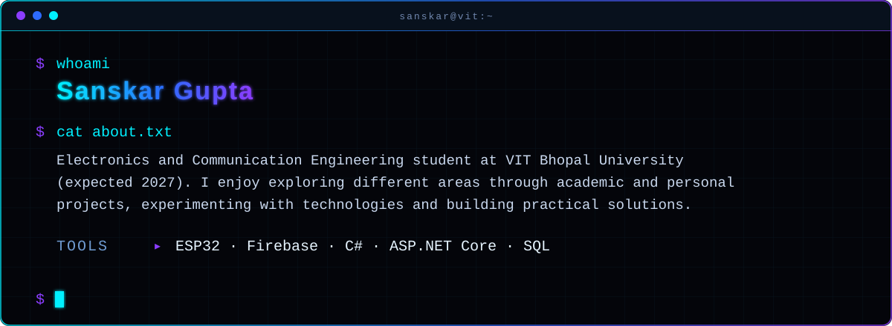
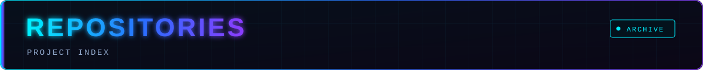

 

<!-- ======================= ABOUT ======================= -->

 

<!-- ======================= REPOSITORIES ======================= -->

 

<table width="100%">
<tr>
<td width="50%">

</td>

<td width="50%">

</td>
</tr>

<tr>
<td colspan="2" align="center">

</td>
</tr>
</table>

<!-- ======================= ACTIVITY ======================= -->

 

<!-- Generated by .github/workflows/snake.yml and published to the "output" branch -->

<!-- ======================= CONTACT ======================= -->

